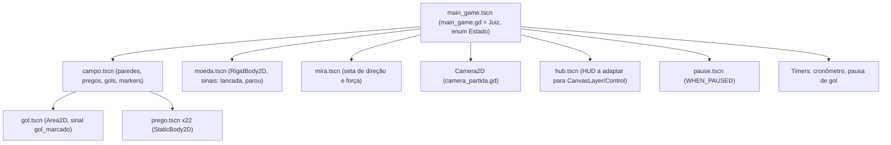

# FutCoin: Planejamento Técnico

> Status em **11/11/2026**: **M0 a M3 concluídos**, partida e fluxo implementados; M4 permanece em polimento de áudio e M5 em export/teste Linux. FEAT-006 centralizou catálogo/seleção em DadosTimes; FEAT-007 entregou seta por força; FEAT-008 entregou brasões Lanczos no Hub e pause acima do HUD. Duração aprovada de 300 segundos. Últimas evidências: 127 verificações na suíte 004 e 8.288 na 003, zero falhas; execuções datadas nas specs/relatórios, não repetidas nesta atualização documental.

Entrega de regras e UI de partida: [FEAT-004 — juiz, turnos, gols e cronômetro](../.agent/features/feat-004-juiz-turnos-gols-cronometro.md) concluída em 10/11, incluindo diagnóstico e resolução de bugs em [TS-004](../.agent/troubleshooting/ts-004-regras-moeda-gol-e-pause.md).

[FEAT-005 — interface, fluxo e áudio](../.agent/features/feat-005-interface-fluxo-audio.md) concluída: `hub.tscn`, `gol.tscn`, `pause.tscn`, `tela_versus.tscn`, `tela_final.tscn`, `menu_principal.tscn`, `creditos.tscn` e toda a infraestrutura de áudio (`AudioManager`, `Sounds`, `AudioMoeda` e 5 barramentos) 100% integrados e validados no fluxo F5.
> Base atual: requisitos, ADR-001 e FEAT-000 a 008. Cena inicial `menu_principal.tscn` configurada; HUD integrado. Export/teste Linux ainda não demonstrado. Notas de diagnóstico e rascunhos datados abaixo são históricos e não substituem as decisões atuais.
> Prazo de entrega: **20/11/2026**. Godot 4.7, GDScript, 2D top-down. Datas do roadmap são metas, não evidência de execução.
> Notas técnicas da seção 3 foram registradas em 06/11; APIs devem ser conferidas durante a implementação. FEAT-002 validada no editor e renderizada no Godot 4.7.2; evidências na spec e no relatório da sessão.

---

## 1. Auditoria de diretórios (vs. skill `godot-game-dev`)

### Organização realizada em 06/11
| Ação | Motivo |
|:---|:---|
| Renomeados 13 PNGs para `snake_case` sem acento ou espaço (ex.: `Estádio de Futebol em Pixel Art.png` → `campo_estadio.png`) | Skill exige `snake_case`. Espaços e acentos dão problema em scripts e `res://`. Nenhum arquivo era referenciado ainda. |
| Removidos os `.png.import` antigos | O Godot os regenera ao abrir o projeto (novos UIDs, sem referências quebradas). |
| Removidas as pastas vazias `scenes/referencia`, `scripts/referencia`, `scenes/ui/times`, `scripts/ui/times`, `assets/sprites/field` | YAGNI. `referencia` é para easter eggs, `ui/times` não espelhava nada, `sprites/field` duplicava `assets/levels`. |
| Criada `build/` (com `.gitkeep`) | Exigida pelo enunciado e pela skill. |

### Estado atual e pendências
| Item | Situação | Recomendação |
|:---|:---|:---|
| Governança | `AGENTS.md`, `.agent/` e `relatorios/` rastreados no Git local | Versionamento autorizado em 09/11; publicação remota não verificada nesta revisão |
| `image.png` (prova de autorização) na raiz | O Godot a importa como recurso. Está linkada no README | Mover para `.docs/creditos/` + `.gdignore`, ajustando o link do README (só com seu aval) |
| `README.md` | Conteúdo correto. A URL do Reddit carrega parâmetros de anti-bot (`js_challenge`, `jsc_token`) | Limpar a URL para o link base do post (só com seu aval) |
| `default_bus_layout.tres` | Implementado com AudioManager, Sounds e AudioMoeda | Ajustar mixagem no M4; não recriar infraestrutura |
| Dados dos times | Catálogo e seleção estática centralizados em DadosTimes, com nove clubes | Manter autoridade única; sem Resource/novo Autoload |
| `project.godot` (Forward Plus + `d3d12`) | Renderer mantido por decisão do usuário | Reavaliar no M5 com o ambiente Linux alvo |
| Assets | Campo, moeda, pregos, menus, áudio e brasões integrados; HUD usa derivados Lanczos 18×18 | Preservar originais e atribuições; fechar pendências de áudio no M4 |
| Gameplay e HUD | Partida completa, HUD e pause integrados; cinco minutos e seleção dos clubes | Polimento de áudio e teste/export Linux permanecem |

### Estrutura-alvo
```text
fut-coin/
├── .agent/ .docs/ relatorios/        (governança e documentação)
├── assets/
│   ├── _fonte/        (originais grandes, com .gdignore)
│   ├── fonts/ levels/ shaders/ sounds/
│   ├── sprites/entities/             (moeda, pregos)
│   └── ui/{hud,menus,times}/
├── build/                            (executável Linux)
├── scenes/{entities,levels,ui}/
├── scripts/{autoload,data,entities,levels,ui}/
├── default_bus_layout.tres
└── project.godot
```

---

## 2. Análise dos assets originais (histórico de 06/11)

Esta seção descreve os originais anteriores ao pipeline. As necessidades de recorte, extensão e geração de imagens abaixo foram atendidas pela FEAT-001; resultados finais na seção 2.1. Campo, tiles e pregos foram integrados pela FEAT-002 e moeda pela FEAT-003; regras e telas foram integradas pelas FEAT-004/005, com refinamentos FEAT-006 a 008.

| Asset | Dimensão | Observação |
|:---|:---|:---|
| `campo_estadio.png` | 1536×1024 (área útil 1504×844, proporção ~1,78:1) | Campo **completo em uma só tela**, com moldura, gols nas pontas e listras horizontais de grama |
| `pregos_prata_vermelho.png` | 1536×1024, 2 pregos de ~150 px no centro | Folha quase vazia (precisa de recorte). ~12 "pixels de arte" por prego |
| `moeda_50_centavos.png` | 1278×1230 (moeda de ~986 px) | **1 frame só**, ~80 "pixels de arte" de diâmetro, texto "50 CENTAVOS" |
| `placar_banner.png` | 2172×724 | Moldura do placar com 2 caixas de brasão, "X" central e caixa de tempo. Está **vazia** (as caixas são pretas) |
| 9 brasões `times/*.png` | 2400×2400, ~28 KB cada | Cores chapadas, grandes demais para o jogo |

### Conclusões
1. **Os assets têm densidades de pixel diferentes.** Cada um foi feito em escala própria (prego ~12 px por pixel de arte, moeda ~12 px por pixel de arte mas com ~80 px de diâmetro, campo em outra grade). Colocá-los na mesma cena com um único fator de escala dá pixels de tamanhos misturados, ou seja, não parece 16 bits de verdade. **Cada asset precisa ser reamostrado para o tamanho final do jogo** (pipeline de assets, Fase 0) antes de ir para `assets/`.
2. **A moeda em ~14 a 16 px (480×270) destrói o detalhe.** O texto "50 CENTAVOS" some. Opções: redesenho simplificado (recomendado) ou tamanho maior.
3. **O campo não tem proporção para rolagem.** Com 1,78:1 e a altura inteira visível, ele cabe na tela e a câmera não precisaria se mover, o que contradiz a Seção 5 dos requisitos (campo de 1,5× a 2× a largura). Solução: **estender o campo**. As listras são horizontais e emendam bem. Corta-se entre a grande área e o círculo central, insere-se faixa de grama, e o outro lado é o espelho. Ver P2.
4. **Não existe spritesheet animado** (moeda, gol, prego). O enunciado exige "animação de sprites **e tiles**". Hoje não há nenhum tile (o campo é uma imagem única). Ver P4.
5. **O banner do HUD está pronto para receber** brasões, gols e tempo como `Control` por cima. Precisa de recorte e redução.
6. **Créditos:** os brasões são de `_EasilyImpressed` (README, com prova de autorização). Os demais assets parecem gerados por IA. Declarar a origem na tela de créditos.

### Comparação histórica de resolução (decisão vigente: 640×360)
| Opção | Escalas inteiras | Moeda / prego / brasão | Comentário |
|:---|:---|:---|:---|
| 480×270 (proposta original) | ×2 = 960×540, ×4 = 1080p. **720p não é inteiro** | ~16 / 10 / 24 px | Moeda ilegível. Em notebook 1366×768 ou 720p, fica com borda preta |
| **640×360 (recomendada)** | ×2 = **1280×720**, ×3 = **1920×1080** | **~24 / 14 / 32 px** | Cobre as telas comuns, preserva detalhe da moeda e do HUD, ainda é "pixel grande" |

Valores iniciais em 640×360: HUD ~48 px no topo, campo útil ~312 px de altura, campo de ~1000 a 1280 px de largura (≈1,6× a 2× a tela). A resolução base é **parametrizada nas Project Settings**, então trocar de ideia custa poucos minutos, desde que os assets finais sejam gerados com o pipeline.

---

### 2.1 Proporções e animações (revisão de 06/11, **validado e executado na FEAT-001**)

**Medidas (estimativas visuais):**
| Asset | Tamanho útil | Pixel de arte | Em pixels de arte |
|:---|:---|:---|:---|
| Moeda | ~986 px | ~14 px | ~70 |
| Prego | ~150 px | ~15 px | ~10 |
| Campo (área interna) | ~1280×662 px | ~12 a 14 px | ~95×50 |
| Gol (abertura) | ~270 px (~40% da altura do campo) | n/d | n/d |

A moeda e o prego estão em escalas diferentes (70 contra 10 pixels de arte). Cada asset é reamostrado para seu tamanho final.

**Composição vigente do campo e integração futura do HUD (640×360):**
Imagem do campo 1152×320 em escala 1, com área interna local entre y=32 e y=288 (256 px de altura). Composição aprovada em 10/11 para FEAT-005: preservar banner de 44 px, campo começando visualmente em Y=44 e recorte de 4 px da decoração inferior. Área jogável permanece integral. Ajustar câmera/limites conforme spec, sem mover posições físicas ou somar deslocamento de campo e câmera duas vezes. Composição implementada/renderizada conforme FEAT-005; estudo anterior de faixa de 40 px não foi adotado.

| Elemento | Tamanho proposto |
|:---|:---|
| Moeda | 28 px (faixa 24 a 32) |
| Cabeça do prego | 12 a 14 px |
| Gol (abertura) | ~72 px (4,5 tiles), reduzido da arte original (~117 px na escala 0,435) |
| Campo em largura | ~1100 a 1200 px (a arte atual daria só ~560 px; inserir ~500 a 600 px de grama entre a grande área e o círculo central, lado oposto espelhado) |

**Derivações dos originais já geradas pela FEAT-001.** A tabela descreve o planejamento histórico da geração; campo, tiles e recursos de animação dos pregos foram integrados na FEAT-002. Moeda e demais telas ainda serão integradas:
| Item | Origem atual | Geração por script |
|:---|:---|:---|
| Moeda | 1 quadro estático | Sheets de brilho, giro 2D top-down e flip (8 quadros), com versão dourada. Decisão vigente: usar giro/brilho por quadros, sem rotação física; flip guardado |
| Moeda (texto) | "50 CENTAVOS" | Remover "CENTAVOS", manter "50" e estrelas (ilegível em 28 px) |
| Prego | 2 quadros estáticos (prata e vermelho) | Piscada e achatamento ao colidir (3 a 4 quadros) |
| Campo | Imagem única, sem tiles | Recortar em `TileMapLayer` de 16 px (grama, linhas, paredes, cantos, gol); a extensão vira repetição de tiles |
| Tile animado 1 | n/a | Borda vermelha e parafusos com luz correndo (ciclo de paleta, 3 a 4 quadros) |
| Tile animado 2 | n/a | Rede do gol ondulando no gol |
| Tile animado 3 (opcional) | n/a | Tufos de grama balançando |

**Pregos por time (decisão do usuário, 06/11):** o asset tem 2 pregos (prata e vermelho). Serão **recortados individualmente** em `prego_prata.png` e `prego_vermelho.png`. Cada cor fica de um lado do campo: **11 pregos prata = time do lado esquerdo e 11 vermelhos = time do lado direito** (22 no total, formação 4-4-2 espelhada). A cor do prego identifica o lado/time e não vem do `TimeDados`. A cena `prego.tscn` recebe um `@export` com a textura (ou o time dono).
- **Times fixos nesta fase (decisão do usuário, 06/11):** **não há seleção de times por enquanto**. Os dois times ficam estáticos para testes, antes de implementar a tela de seleção. **Corinthians = player 1, prego prata, lado esquerdo. Flamengo = player 2, prego vermelho, lado direito.** Na seleção futura, o time da esquerda será o player 1 e o da direita o player 2. Os outros 7 brasões ficam importados, fora do MVP. O lado que começa continua sorteado (ver P10).
- **Mouse compartilhado:** os dois jogadores usam o mesmo mouse (coop local) e se revezam. Não há dono fixo de dispositivo.
- **Contraste prego × moeda (decisão do usuário):** o prego prata será **escurecido e ganhará leve tom azulado (aço/grafite)** no pipeline, para se distinguir do cinza claro da moeda, mantendo contorno preto e brilho. Verificação visual no M1 continua valendo; se ainda parecer próximo, escurecer mais.
- **Indicador de posse/vez (decisão do usuário):** borda pulsante **rente à moeda**, com a cor do time autorizado a jogar: aço azulado dos pregos do Corinthians ou vermelho dos pregos do Flamengo. FEAT-003 implementou arco de raio 14/traço 2, pulso por Tween e parâmetro `cor_posse`; a prévia ainda usa cor fixa esbranquiçada. FEAT-004 atualizará a cor a cada turno; FEAT-005/M4 conferirá paleta/contraste. Fica ativa em `AGUARDANDO_JOGADA`/`MIRANDO` e some em movimento. O HUD pode reforçar a indicação de vez.
- **Seta (aprovada em 11/11):** amarela até 1/3, laranja até 2/3 e vermelha acima, preservando contorno e comprimento/direção; bloqueio cinza com X. Não usar o antigo rascunho de amarelo fixo como requisito atual.

**Backup e reprodutibilidade:** os 14 originais (13 iniciais mais a tela de matchup do Gianlucca, `tela_versus.png`) estão em `assets/_fonte/` (com `.gdignore`, o Godot não os importa). O processamento foi automatizado pelo script versionado `assets/_fonte/processar_assets.py` (**FEAT-001 concluída**, commit `18bbc6b`), incluindo spritesheets de brilho, giro 2D top-down (`moeda_giro_sheet.png` e `moeda_dourada_giro_sheet.png`), flip, pregos de 12×12 px (`prego_prata.png` em tom aço e `prego_vermelho.png`) + colisão, campo estendido `1152×320`, `campo_tileset.png` (`128×128` com 4 linhas de tiles animados), banner `320×44`, 9 brasões em `48×48` e `tela_versus.png` em `640×360`.

---

## 3. Notas técnicas do planejamento inicial (conferir APIs ao implementar)

1. **Renderer:** mantido `Forward Plus`, com driver Windows `d3d12`, por decisão do usuário. A sugestão inicial de trocar para Compatibility não foi adotada. Compatibilidade com a máquina Linux alvo será verificada no M5, antes de decidir qualquer mudança.
2. **Pixel perfect:** já configurados viewport 640×360, stretch `viewport`, escala `integer`, filtro `Nearest` e snap 2D. Verificação visual integrada ainda depende das cenas de gameplay/HUD.
3. **Física:** gravidade 2D zero e `physics/common/physics_interpolation=true` já configurados. Comportamento da moeda e da câmera ainda será verificado no M1.
4. **Moeda (`RigidBody2D`):** `continuous_cd = CAST_SHAPE`; `linear_damp_mode = REPLACE`; `PhysicsMaterial` (bounce ~0,6 a 0,8, friction ~0); `lock_rotation = true` (rotação arbitrária de pixel art gera serrilhado, então o "rolar" é feito por animação de frames). Lançamento por `apply_central_impulse`. **O limite de velocidade não existe nativamente: clampar em `_integrate_forces(state)`.** Nunca alterar `linear_velocity` em `_physics_process`. Atenção: um corpo dormindo para de chamar `_integrate_forces`.
5. **"Moeda parada":** velocidade abaixo de um limiar (`@export`) por um tempo curto (`Timer` ou contador), em vez de confiar só no *sleep* do motor. Fallback: sinal `sleeping_state_changed`.
6. **Gol inteiramente dentro:** a simplificação inicial de afastar Area e confiar em CCD foi substituída pelo planejamento da FEAT-004. Validar círculo completo além da linha (centro X≤34 ou ≥1118, Y=138..182) e amostrar deslocamento entre passos para travessias rápidas. Area gera candidatos; sobreposição parcial não pontua e CCD não garante evento de sensor. Proposta ainda exige testes na implementação.
7. **Câmera:** `Camera2D` fora do `RigidBody2D`, com script que copia só `x` da moeda. `y` fixo. `limit_left/right` calculados a partir do campo. `process_callback = PHYSICS`. Smoothing ligado, com teste de jitter já na Fase 1. Se persistir: desligar smoothing e arredondar a posição. Ao reposicionar a moeda após gol: `reset_smoothing()` + `reset_physics_interpolation()`.
8. **Pause:** `get_tree().paused = true`. O menu de pause com `process_mode = WHEN_PAUSED`. `AudioManager` com `ALWAYS`. Nós `Timer` e física (padrão `INHERIT`) congelam sozinhos. Para pausar o cronômetro durante a animação de gol: `Timer.paused = true`.
9. **Tiles animados:** `TileMapLayer` (o `TileMap` está depreciado) + `TileSetAtlasSource` com animação por tile (frames na horizontal, colunas, duração por frame). Atende "animação de tiles" com pouca arte.
10. **Pastas só de fonte:** um `.gdignore` na pasta faz o Godot ignorá-la (sem importar e sem aparecer no FileSystem). Ideal para `assets/_fonte/`.
11. **Exportação Linux a partir do Windows:** baixar os *export templates* da versão exata (Editor → Manage Export Templates). Criar o preset Linux cedo. Ver riscos na Seção 7.

---

## 4. Arquitetura aprovada (ADR-001; componentes a implementar)

### Juiz + componentes + dados estáticos
Segue o catálogo da skill: *Call Down, Signal Up*, estado explícito e DRY de transição.

**Alinhamento de gameplay em 10/11:** prévias são ferramentas isoladas F6; a partida final será `main_game.tscn`, integrando os componentes existentes. FEAT-004 deve ocultar moeda/mira ao confirmar gol e coordenar animação/reinício. FEAT-005 deve reutilizar `hub.tscn` e reservar espaço superior para placar/cronômetro, ajustando composição e câmera sem cobrir campo jogável. A margem atual de 20 px não acomoda automaticamente o banner de 44 px. Física aceita pelo usuário; câmera aceita provisoriamente e reavaliada com HUD integrado.



- **Estados da partida** (`enum Estado`): `AGUARDANDO_JOGADA`, `MIRANDO`, `MOEDA_EM_MOVIMENTO`, `GOL_ANIMANDO`, `FIM_DE_PARTIDA`. Pause é do `SceneTree`, não um estado. O gol de ouro é uma *flag* (`gol_de_ouro_ativo`).
- **Tempo esgotado em movimento:** flag `tempo_esgotado`, avaliada no sinal `moeda.parou` (e após gol). Atende a Seção 3.3.
- **Dados entre cenas:** classe com `static var` (`PartidaConfig`: time A, time B, duração), sem autoload só para transporte.
- **Times:** Corinthians/P1/prata/esquerda e Flamengo/P2/vermelho/direita fixos, com dados estáticos; sem `TimeDados` como Resource e sem pasta `resources/`.
- **UI:** cada tela implementa `_transicionar_para(caminho)` com componente `Sounds` (desabilita botões, toca som, despausa e troca de cena); sem herança de `TelaBase`.
- **Autoload:** apenas `AudioManager` (música contínua entre cenas, mudo de SFX no pause). Os demais ficam locais.
- **Pregos:** `prego.tscn` instanciado 22× como filhos de `Marker2D`, com posições ajustáveis no editor (Seção 4 dos requisitos). Espelho do lado B por duplicação, com `@export` do time dono.
- **Mira:** `_unhandled_input` + `get_global_mouse_position()` (a câmera se move). Ações no Input Map (`mira_clique`, `pausar`), sem teclas fixas no código.
- **Parâmetros `@export`:** duração, força máxima, zona morta/escala do arrasto, amortecimento e tolerância de contato. Gol de ouro é obrigatório, sem parâmetro de desativação (decisão de 10/11). Esclarecimento de 09/11: força retorna a zero junto à moeda; parede em contato bloqueia tiro contra ela, sem reduzir força apenas por proximidade. Contratos e critérios em [FEAT-003](../.agent/features/feat-003-moeda-mira-camera.md).

### Alternativa descartada no alinhamento inicial
Cena `partida` com **um único script grande** (moeda, turnos, HUD e pause inline) e sem `TelaBase` (cada menu com seu `change_scene_to_file`). **Prós:** menos arquivos, começa mais rápido. **Contras:** código duplicado, `partida.gd` com 400+ linhas, mais difícil de explicar na arguição individual e de dividir entre 4 pessoas. Não recomendada, dado o critério de "qualidade do código".

### 4.1 Alinhamento histórico com o catálogo da skill (06/11)

As escolhas de não usar TelaBase/Resource continuam vigentes. Times fixos e seleção adiada eram o escopo inicial; a entrega atual possui nove clubes e DadosTimes conforme FEAT-005/006.
A arquitetura segue o `catalogo-padroes-godot.md` da skill `godot-game-dev`. O rascunho acima é corrigido assim:
| Rascunho | Segundo a skill |
|:---|:---|
| Classe `TelaBase` com herança | `_transicionar_para()` em cada tela + componente `Sounds` nos botões. **`TelaBase` removida** |
| `TimeDados` (`Resource`) e `resources/times/` | Passagem de dados por `static var` (DTO estático). Times fixos (Corinthians e Flamengo) nele. **Pasta `resources/` removida** |
| Juiz da partida com nome livre | `scenes/levels/main_game.tscn` + `scripts/levels/main_game.gd` |
| Sensores de gol soltos | Grupos `sensores_*` + `_conectar_grupo_sensores()` |
| Cronômetro formatado em cada tela | Formatação estática (`Hub.formatar_tempo()`) |
| Tela final sem fallback | `_carregar_dados_padrao_teste()` para rodar no F6 |

Mantidos: `AudioManager` (autoload, 5 barramentos, mudo no pause), componente de áudio da moeda, `Timer` nativo, `enum Estado`. Telas: menu, `main_game`, pause, final, créditos (seleção de times fica para depois dos testes).

**Resolução 640×360 decidida.** Renderer/Vulkan: fora das pendências por ora (desenvolvimento em 2 máquinas Windows). Risco restante: o build Linux roda em Forward+ e precisa de Vulkan na máquina que abrir o jogo. Reavaliar perto do export.

---

## 5. Roadmap (06/11 → 20/11)

| Marco | Datas | Entregas | Critério de pronto |
|:---|:---|:---|:---|
| **M0 Fundação (CONCLUÍDO)** | 06/11 | Respostas da Seção 6; `ADR-001`; `FEAT-000` (Project Settings 640×360 + Input Map `mira_clique`/`pausar`); `FEAT-001` (pipeline de assets + `.import`) | Projeto abre em 640×360 pixel perfect; 24 assets finais importados (commits `5ccfcd8`, `18bbc6b`, `d0ea75a`) |
| **M1 Núcleo físico (concluído)** | 08 a 11/11 | FEAT-002/003 concluídas: campo, 22 pregos, tiles, moeda (`28×28`), mira, bloqueio contra parede em contato, parada e câmera | Prévia F6 jogável; revisão de borda/seleção com 8.288 verificações sem falhas, editor e renderização conferidos. Física aceita; ambiente Linux sujeito a avaliação |
| **M2 Regras (concluído)** | Implementado em 10/11; revalidado em 11/11 | Juiz, gols, turnos, cronômetro de 300 s e gol de ouro | Suíte 004 com 127 verificações sem falhas na última execução registrada |
| **M3 Fluxo e UI (concluído)** | Implementado em 10/11; refinado em 11/11 | Menus, nove clubes, final/créditos, pause/HUD e infraestrutura de áudio | Fluxo integrado; refinamentos FEAT-006/007/008 aprovados |
| **M4 Arte e polimento** | 15 a 18/11 | Animação de sprite, de tile e Tweens, SFX/música, balanceamento, tremor de câmera (opcional) | Checklist do enunciado 100% |
| **M5 Entrega e Export Linux** | 18 a 20/11 | Preset e export final Linux em `build/`, `.gitattributes` (`build/** binary`), `chmod +x` versionado, créditos finais, `roteiro_apresentacao.md` | Submissão no Classroom, buffer de 1 dia |

### Divisão sugerida (4 pessoas, com rodízio, pois todos serão arguidos sobre tudo)
| Papel | Foco | Revisa o código de |
|:---|:---|:---|
| A (Física) | Moeda, mira, pregos, câmera | B |
| B (Regras) | Juiz da partida, estados, gols, cronômetro | A |
| C (UI/Fluxo) | Menus, versus com seleção dos nove clubes, final, créditos, pause, HUD e componente Sounds | D |
| D (Arte/Áudio/Export) | Pipeline de assets, animações, áudio, créditos, build Linux | C |

Regra: **todo PR é revisado por quem não escreveu**. Antes da apresentação, cada um explica o módulo de outro.

---

## 6. Status dos Pontos de Alinhamento (P1 a P14)

| # | Questão | Status / Decisão |
|:---|:---|:---|
| P1 | **Resolução base:** 480×270 ou 640×360? | **Concluído:** `640×360` aplicada no `project.godot` (`5ccfcd8`) |
| P2 | **Campo:** estender a arte atual (corta/insere grama/espelha)? | **Concluído:** Campo estendido para `1152×320` com gol de `~72 px` (`18bbc6b`) |
| P3 | **Pipeline de assets:** reamostrar/redesenhar cada asset para o tamanho final? | **Concluído:** Gerado por `assets/_fonte/processar_assets.py` (moeda `28×28`, pregos `12×12`, brasões `48×48`, banner `320×44`, versus `640×360`) |
| P4 | **Animação de tiles e spritesheets** | Integradas: TileMapLayer animado, impactos/giro/brilho, variante dourada e Tweens/partículas nas telas. Qualidade audiovisual final segue no polimento |
| P5 | **Moeda sem rotação física** (`lock_rotation`) com animação por quadros (`moeda_giro_sheet.png` / `moeda_brilho_sheet.png`) | **Decidido:** Usar giro 2D top-down / brilho no deslize; manter `moeda_flip_sheet.png` guardado |
| P6 | **Pasta `resources/times/`** vs. DTO estático da skill | **Decidido:** Seguir a skill (DTO estático `static var`, sem `resources/`) |
| P7 | **Versionamento da governança** | **Atualizado em 09/11:** `AGENTS.md`, `.agent/` e `relatorios/` versionados no Git local por autorização do usuário; publicação remota não verificada nesta revisão. `assets/_fonte/` também versionada |
| P8 | **Times e cores por jogador/lado** | Nove clubes selecionáveis; catálogo/seleção centralizados em DadosTimes (FEAT-006). Hub usa derivados Lanczos 18×18 (FEAT-008); sem listas exportadas concorrentes |
| P9 | **Project Settings** e **Export Linux** | **Concluído:** `640×360` + `Nearest` + `snap` + gravidade zero + Input Map aplicados; tudo referente a Linux fica para o M5 |
| P10 | **Gol de ouro** | **Decidido em 10/11:** novo sorteio independente, inclusive no 0×0; obrigatório em empate após fim do tempo/última jogada, sem desativação. Primeiro gol decide; pausa/menu/saída disponíveis |
| P11 | **Áudio e atribuições** | Assets locais integrados; mixagem e mapeamento arquivo→autor permanecem em M4 conforme inventário de créditos |
| P12 | **Pause:** menu com Continuar, Reiniciar e Menu (`WHEN_PAUSED`) | **Aprovado** (`ADR-001`) |
| P13 | **Testes:** só F6 + scaffolding (Nível 1), sem GUT | **Decidido:** Validar no editor com scaffolding F6 |
| P14 | **Distribuição de papéis** da Seção 5 e integrantes nos créditos | **A definir pelo grupo** |

**Decisão de balanceamento após FEAT-002:** manter os goleiros em `(51,160)` e `(1100,160)`, incluindo assimetria de 1 px. Quando a moeda estiver jogável, avaliar a dificuldade; poderá haver retorno às posições originais `(104,160)`/`(1048,160)` ou busca de novas posições, mediante alinhamento. Não ajustar automaticamente.

---

## 7. Riscos

| Risco | Impacto | Mitigação |
|:---|:---|:---|
| Linux **sem bit de execução** ao commitar do Windows | Binário não executa na correção | `git update-index --chmod=+x build/<exe>` e documentar `chmod +x` no README |
| Binário > 100 MB (limite do GitHub) | Push recusado | Exportar com `.pck` separado ou binário embutido enxuto; checar tamanho no M1 |
| `* text=auto eol=lf` do `.gitattributes` tocando binários | Corrupção | Adicionar `build/** binary` |
| Tunelamento ou moeda presa entre pregos | Jogo quebrado | CCD, clamp de velocidade, espaçamento maior que o diâmetro com folga, teste de estresse no M1 |
| Jitter da câmera em pixel art | Visual ruim | Teste já no M1 (Seção 3.7) |
| Divergência de proporção entre arte e câmera | Retrabalho de arte | Resolver P1 e P2 antes do M1 |
| Prazo apertado e tarefas dependentes | Atraso (5% por dia) | Marcos curtos, M1 e M2 em cinza (arte depois), buffer final de 1 dia |
| Origem de assets de IA e licenças | Problema de créditos | Declarar na tela de créditos e no README |
