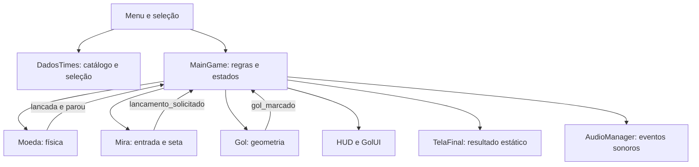

# 🎮 Roteiro de Apresentação e Guia de Estudo — FutCoin

**Disciplina:** Desenvolvimento de Jogos — UFJF  
**Autores:** Gabriel Lineker e Gianlucca Paiva  
**Engine:** Godot 4.7, GDScript com tipagem estática, 2D  
**Base:** código e histórico de commits conferidos em 13/11/2026, após a limpeza autorizada.

Este documento serve como roteiro curto de demonstração e guia detalhado de estudo. Ambos precisam conhecer todo o código. A divisão de falas é uma proposta baseada no Git, não uma declaração de autoria exclusiva. Não foi informado limite de duração da apresentação. Linux continua como etapa final pendente.

## 🎤 Parte 1: Ordem Sugerida para Apresentar o Trabalho

### 1. Abertura e Fidelidade Visual — Menu Inicial

Mostrem F5, menu, créditos e seleção dos nove clubes. Expliquem resolução interna 640×360, escala inteira e arte pixelada. O campo é maior que a tela; o fundo do menu é uma imagem, não um sistema de parallax. Mostrem que os clubes não se repetem. O tigre tem 1% por carregamento: não tentem esperar que apareça durante a fala. Para explicar o sorteio, abram a propriedade no script.

**O que falar:** “Dois jogadores compartilham o mouse e alternam lançamentos. Na seleção, o catálogo é centralizado e impede que os dois lados usem o mesmo clube.”

### 2. Arquitetura da Partida — Desacoplamento por Sinais e Grupos

Abram main_game.tscn: campo, moeda, mira, câmera, timers e FeedbackRegras. O CanvasLayer mantém HUD e menus na tela. Mostrem o aviso do time sorteado e os cinco estados do juiz. Expliquem que pausar a árvore não é acrescentar um estado ao enum; Gol de Ouro é uma flag.

**O que falar:** “O juiz autoriza a jogada e recebe os eventos. Os componentes apresentam ou executam tarefas específicas; não decidem sozinhos placar e vencedor.”

### 3. Física, Controle e Matemática da Moeda

Demonstrem puxada curta/longa, retorno da força a zero, ricochete mesmo encostado e câmera horizontal. Abram mira.gd e moeda.gd. Expliquem vetor oposto à puxada, normalização, saturação e limite de velocidade. Não confundam impulso com uma força aplicada continuamente. Mostrem por que só se libera o próximo turno depois da parada confirmada.

### 4. Interações do Cenário — Campo, Pregos e Gols

Não há IA ou inimigo controlado por computador neste projeto. Mostrem os 22 pregos, paredes e dois sensores. Um prego é estático; a moeda é o corpo dinâmico. Os times recebem cor via shader. Demonstrem colisão/animação de impacto e expliquem por que uma moeda parcialmente dentro do gol não pontua. Mostrem TileMapLayer/TileSet animado como requisito distinto da animação de sprites.

### 5. Áudio Dinâmico e Telas de Desfecho

Demonstrem pausa/retomada e mostrem áudio, GolUI e resultado. Expliquem redução temporária da música, torcida curta, apito final e fallback. No empate, há Gol de Ouro obrigatório, sem empate final. A tela final pode ser demonstrada por F6 com dados de exemplo; identifiquem que é demonstração, não uma partida vencida de verdade. Mostrem Jogar Novamente, Trocar Times e Menu.

Se o professor pedir alteração pontual, indiquem parâmetros reais: duração em MainGame, impulso/velocidade em Moeda, amortecimento/material na cena, chance do tigre no menu. Uma demonstração com valor temporário deve ser revertida; não deixar tempo de teste na entrega.

## 🧠 Parte 2: Como a Arquitetura Funciona

- **De Cima para Baixo:** MainGame chama moeda.lancar(), mira.definir_habilitada(), hub.atualizar_placar() e sensor.armar(). O pai coordena sem copiar a física ou o desenho da UI.
- **De Baixo para Cima:** Mira emite lancamento_solicitado; Moeda emite lancada/parou; Gol emite gol_marcado; Pause emite continuar_solicitado/reinicio_solicitado/menu_solicitado. O juiz recebe e valida estado/ID.
- **Chamada em Grupo:** o código usa get_nodes_in_group("sensores_gol") e conecta cada sensor descendente da partida. Não há call_group() de gameplay para apresentar. O filtro is_ancestor_of evita que uma partida receba o sensor da outra nos testes.
- **Passagem de Dados:** DadosTimes guarda seleção estática; TelaFinal.definir_resultado() prepara um resultado estático consumido ao abrir. O AudioManager é o único Autoload, registrado como GerenciadorAudio; não existe um singleton só para transportar placar.
- **Ordem dos eventos:** a resolução adiada prioriza gol válido, expiração e parada, nessa ordem. IDs de partida/jogada descartam eventos antigos e duplicados. Não simplificar esses controles como se fossem repetição inútil.

## 📂 Parte 3: Guia Completo de Cada Arquivo `.gd`

Cobertura: **21 arquivos** — 18 da aplicação/prévia, duas suítes e uma ferramenta offline. A geração de imagens em Python e os shaders não são GDScript; aparecem como apoio na explicação de assets/pregos. As funções abaixo correspondem aos nomes atuais, após remover os três métodos sem consumidores e o suporte vazio de áudio.

# 🔊 1. Sistema Global e Dados

## 📄 Arquivo: `audio_manager.gd`

- **Pasta:** scripts/autoload/audio_manager.gd.
- **Cena:** Autoload GerenciadorAudio, configurado em project.godot.
- **Tipo do Nó Raiz:** Node, class_name AudioManager.

### 🎯 O que este arquivo faz?

Mantém música entre telas e executa os eventos sonoros da partida. É global porque trocar de cena não deve recriar ou interromper arbitrariamente a música. O controlador tem quatro players ativos: música, eventos, fogos e torcida de gol. A antiga torcida contínua não está mais implementada.

### 🧱 Nodes Utilizados na Cena e Por Quê

AudioStreamPlayer reproduz áudio sem posição espacial. Players separados permitem combinar música, evento, fogos e torcida. Os cinco barramentos são Master, SFX, Music, Ambiente e UI; Ambiente continua atendendo a torcida curta. Tweens animam volume, sem implementar um mixer manual por frame.

### 🔧 Principais Variáveis, Sinais e Constantes

instancia oferece acesso estático ao Autoload; constantes CAMINHO_* identificam recursos locais. VOLUME_MUSICA_PADRAO_DB=-4, DUCKING=-14 e PAUSE=-12 definem a mixagem atual. Variáveis de mute guardam o estado anterior à pausa. Não existe stream configurado de torcida contínua.

### ⚙️ Como as Funções Funcionam

- `_ready()`: registra instancia, define ALWAYS, garante barramentos, carrega streams e cria players.
- `_exit_tree()`: cancela Tween, para/libera referências dos players e limpa instancia se ainda aponta para este nó.
- `_process()`: acompanha mudança de pausa chamando `_sincronizar_estado_pausa_imediato()`; esta compara o estado atual com o anterior e só aplica mudança quando necessário.
- `_aplicar_estado_pausa_audio()`: guarda/restaura mute de SFX/Ambiente e anima o volume musical. A UI continua disponível durante pausa.
- `tocar_inicio_partida()`: limpa comemoração/fogos, sincroniza áudio, toca saída e reinicia música normal.
- `tocar_gol_de_ouro()`: faz limpeza equivalente, toca saída e inicia a faixa de Gol de Ouro.
- `tocar_apito_reinicio()`: toca o stream de saída com pitch/volume definidos, usado no início, após gol e no Gol de Ouro.
- `tocar_gol()`: combina efeito e torcida, calcula a duração relevante e reduz a música temporariamente.
- `obter_tempo_comemoracao_restante()`: consulta duração menos posição de reprodução dos sons de gol ativos; limita a espera a 0..10 s.
- `tocar_fim_partida()`: reduz música, toca apito final e devolve o player para o juiz aguardar finished; retorna null se não houver áudio ou em headless.
- `tocar_tela_vitoria()`: limpa comemoração/música e inicia vitória/fogos.
- `tocar_musica_menu()`: mantém a mesma música entre menu e seleção, sem reinício desnecessário.
- `parar_audio_partida()`: interrompe torcida, evento, fogos e música na saída.
- `executar_musica()`: trata null, evita reinício da mesma faixa quando não solicitado e aplica volume padrão; `parar_musica()` interrompe o player.
- `executar_torcida_gol()`: prepara stream/volume e reproduz a torcida curta; `parar_torcida_gol()` a interrompe.
- `executar_sfx_evento()`: reutiliza player de eventos, ajustando stream, pitch e volume; `executar_fogos()` faz o equivalente no player próprio; `parar_fogos()` o interrompe.
- `aplicar_ducking_temporario()`: Tween baixa volume em 0,1 s, espera conforme duração e restaura em 0,25 s. `_cancelar_tween_ducking()` mata uma animação anterior antes de outra assumir o volume.
- `_garantir_barramentos()`: cria somente os barramentos ausentes e envia ao Master.
- `_carregar_streams_padrao()`: carrega recursos locais quando exports estão vazios e configura loops das músicas/fogos.
- `_criar_players()`: cria os quatro players com seus barramentos e modos de processamento.
- `_animar_volume_musica()`: substitui Tween ativo e interpola para o volume pedido, usada na pausa e no encerramento.

## 📄 Arquivo: `dados_times.gd`

- **Pasta:** scripts/data/dados_times.gd.
- **Cena:** nenhuma; classe de dados chamada pelas cenas.
- **Tipo do Nó Raiz:** não possui nó; RefCounted, class_name DadosTimes.

### 🎯 O que este arquivo faz?

Centraliza nove clubes, texturas, siglas, nomes, cores e seleção. Evita que cada tela mantenha sua própria lista. Usa estado estático para a seleção entre cenas; não exige um Autoload adicional.

### 🧱 Nodes Utilizados na Cena e Por Quê

Não cria nós. Texture2D são recursos preloaded do catálogo, inclusive brasões HUD menores. As telas consomem os dados para seus próprios sprites e rótulos.

### 🔧 Principais Variáveis, Sinais e Constantes

ORDEM_TIMES define navegação; CATALOGO associa chave a dados. time_esquerdo_selecionado e time_direito_selecionado persistem seleção. cores_personalizadas permanece por decisão de escopo, sem criar uma tela de personalização.

### ⚙️ Como as Funções Funcionam

- `possui_time()`: verifica chave no catálogo; `_obter_dados_clube()` usa Corinthians como fallback para chave inválida.
- `obter_textura_time()` e `obter_textura_time_hud()`: devolvem, respectivamente, textura normal e reduzida.
- `obter_nome_time()` e `obter_sigla_time()`: consultam as formas de texto centralizadas.
- `obter_cor_time()`: prioriza override existente, senão usa catálogo. `definir_cor_time()` aceita apenas clube válido e componentes finitos.
- `definir_times_selecionados()`: valida ambos os lados, aplica padrões e desloca a direita se repetir o clube da esquerda.
- `restaurar_times_padrao()`: restaura Corinthians/Flamengo e limpa overrides para isolar testes.
- `obter_proximo_time_disponivel()`: percorre circularmente com posmod, respeita sinal do passo e pula a chave ocupada; não é seleção aleatória.

# ⚖️ 2. Controle Central do Nível

## 📄 Arquivo: `main_game.gd`

- **Pasta:** scripts/levels/main_game.gd.
- **Cena:** scenes/levels/main_game.tscn.
- **Tipo do Nó Raiz:** Node2D, class_name MainGame.

### 🎯 O que este arquivo faz?

É o juiz: autoriza entrada, alterna turnos, mantém placar/tempo e decide resultado. Resolve eventos próximos sem contar gol duas vezes. Coordena comemoração e cerimônia final; não substitui a integração física da moeda.

### 🧱 Nodes Utilizados na Cena e Por Quê

Campo/Moeda/Mira compõem o jogo; CameraPartida acompanha X. Cronometro, PausaGol, PausaFim e LimiteApitoFinal são Timers para durações reais/fallbacks. FeedbackRegras é CanvasLayer com Hub, GolUI, AvisoCentral e Pause. Sensores Gol são Area2D encontrados pelo grupo.

### 🔧 Principais Variáveis, Sinais e Constantes

Estado possui cinco fases; EtapaFim separa PAUSA/APITO/CONCLUIDA da regra esportiva. placar é Vector2i. duracao_partida=300, duracao_apresentacao_gol=2,2, pausa_antes_apito_final=0,25. id_partida/id_jogada_* invalidam callbacks antigos. gol_de_ouro_ativo, tempo_esgotado e eventos pendentes registram regras. Sinais notificam placar, turno, tempo, estado, gol e vencedor. Os nomes históricos CORINTHIANS/FLAMENGO do enum representam lados; o clube selecionado é consultado em DadosTimes.

### ⚙️ Como as Funções Funcionam

- `_ready()`: inicializa RNG se não houver semente de teste, conecta grupo de sensores e inicia partida. `_exit_tree()` cancela cerimônia final.
- `_unhandled_input()`: Esc abre pausa se partida ativa e não encerrada. `_physics_process()` atualiza o tempo quando muda o segundo exibido.
- `_agendar_resolucao()`: agenda uma única resolução deferred com geração da partida. `_resolver_eventos_pendentes()` ignora geração antiga e processa gol, expiração e parada em prioridade definida.
- `_confirmar_gol()`: conclui ID da jogada, desarma sensores, pausa tempo quando cabível, esconde moeda, soma ponto ao adversário da defesa e inicia GolUI/áudio/Timer.
- `_avaliar_pos_tempo_esgotado()`: para cronômetro e decide vencedor se placar diferente, senão inicia Gol de Ouro.
- `_iniciar_gol_de_ouro()`: ativa flag, muda moeda, reposiciona, sorteia independentemente e habilita nova saída com áudio.
- `_encerrar_partida()`: impede conclusão repetida, bloqueia jogadas, prepara payload TelaFinal e inicia pausa mais eventual resto de comemoração antes do apito.
- `_obter_chave_brasao_equipe()`: resolve lado para chave de clube via HUD/seleção estática.
- `_ir_para_tela_final()`: exige geração, etapa final concluída e cena atual correta antes de trocar.
- `_on_pausa_fim_timeout()`: avança para APITO, inicia som e conecta finished à geração. Se faltar player, conclui; caso contrário arma watchdog de duração+1 s.
- `_on_limite_apito_final_timeout()`: interrompe som que não terminou e aciona conclusão segura.
- `_concluir_apito_final()`: valida estado/geração, cancela watchdog, desconecta sinal e agenda resultado.
- `_cancelar_encerramento()`: para timers/player e invalida cerimônia. `_desconectar_apito_final()` remove conexão ativa e limpa Callable/player.
- `_habilitar_turno()`: aplica time/cor de posse, volta a AGUARDANDO_JOGADA e autoriza mira.
- `iniciar_partida()`: reinicia IDs/flags/placar, sai da pausa, aplica clubes, limpa apresentação, centraliza moeda, inicia 300 s e sorteia com aviso de 1,5 s.
- `reiniciar_partida()`: reutiliza inicialização completa. `cancelar_partida()` invalida geração, para partida/áudio e limpa dados/efeitos para saída.
- `definir_pausada()`: mostra/oculta pausa, cancela arrasto e muda SceneTree.paused, preservando pausa de cronômetro causada por gol.
- `definir_semente()`: injeta seed reproduzível para testes.
- `obter_placar()`, `obter_time_atual()` e `obter_estado()`: expõem estado; `obter_tempo_restante()` devolve tempo não negativo ou zero no Gol de Ouro/tempo esgotado; `esta_em_gol_de_ouro()` expõe flag.
- `_conectar_grupo_sensores()`: filtra sensores descendentes e evita conexão duplicada.
- `_armar_sensores()`: associa moeda/ID a cada sensor; `_desarmar_sensores()` os limpa; `_inspecionar_sensores()` solicita avaliação final antes de resolver parada.
- `_posicionar_moeda_no_centro()`: usa marcador ou centro padrão (576,160), reposiciona moeda e reinicializa câmera.
- `_definir_estado()`: só emite mudança real e sincroniza HUD.
- `_sortear_equipe()`: usa RNG inteiro 0/1. `_equipe_adversaria()` troca lado. `_obter_vencedor_atual()` compara gols; empate é tratado antes de chamar encerramento normal.
- `_cor_equipe()` e `_nome_equipe()`: consultam catálogo a partir da chave do lado. `_aplicar_cores_times_na_partida()` aplica seleção ao HUD e aos 22 pregos.
- `_relogio_regulamentar_esgotado()`: combina flags, timer parado e tempo restante; Gol de Ouro não é bloqueado pelo relógio zerado.
- `_atualizar_feedback_status()`: envia placar, tempo, turno e flag ouro ao HUD.
- `_exibir_aviso_gol()`: prepara GolUI com clubes e duração. `_exibir_aviso_temporario()` mostra Label e agenda fade. `_exibir_aviso_fim()` apresenta vencedor/placar antes da saída.
- `_ocultar_aviso_central()`: oculta avisos e painel de gol. `_cancelar_tween_aviso()` mata a animação anterior para evitar conflito.
- `_on_mira_iniciada()`: valida partida, pausa, relógio e estado antes de MIRANDO. `_on_mira_cancelada()` retorna ao repouso se não houver resolução/tempo esgotado pendente.
- `_on_lancamento_solicitado()`: valida estado, prepara novo ID/sensores e pede tiro. Se moeda recusar impulso, desfaz armamento sem gastar turno.
- `_on_moeda_lancada()`: confirma/arma ID, esconde aviso, entra em movimento e bloqueia entrada.
- `_on_moeda_parou()`: inspeciona sensores antes de enfileirar parada; evita perder gol no mesmo passo.
- `_on_sensor_gol_marcado()`: aceita somente jogada ativa, ainda não concluída ou registrada, e agenda resolução.
- `_on_cronometro_timeout()`: enfileira expiração e bloqueia novas jogadas quando a moeda está parada/mirando.
- `_on_pausa_gol_timeout()`: encerra apresentação e decide entre fim, Gol de Ouro ou moeda no centro com saída de quem sofreu.
- `_on_hub_pausa_solicitada()` abre pausa; `_on_pause_continuar_solicitado()` retoma; `_on_pause_reinicio_solicitado()` reinicia.
- `_on_pause_menu_solicitado()`: cancela partida e agenda saída. `_transicionar_saida_menu()` verifica cena atual, abre menu e informa falha; não manipula nó já destruído pelo sinal.

## 📄 Arquivo: `camera_partida.gd`

- **Pasta:** scripts/levels/camera_partida.gd.
- **Cena:** CameraPartida em main_game.tscn e previa_moeda.tscn.
- **Tipo do Nó Raiz:** Camera2D, class_name CameraPartida.

### 🎯 O que este arquivo faz?

Segue a moeda somente em X. Mantém toda a altura jogável, respeita extremos e evita deslocar HUD junto do campo. A cena define smoothing e altura apropriada para partida ou prévia.

### 🧱 Nodes Utilizados na Cena e Por Quê

Camera2D transforma a vista do mundo; alvo referencia Moeda sem tornar câmera filha do corpo físico. CanvasLayer da partida mantém UI independente.

### 🔧 Principais Variáveis, Sinais e Constantes

alvo é a moeda; altura_fixa vale 136 na partida e 160 na prévia. X é limitado a 320..832, considerando metade do viewport e largura 1152.

### ⚙️ Como as Funções Funcionam

- `_ready()` chama `reposicionar()` para sincronização inicial.
- `_physics_process()` copia X limitado do alvo e aplica Y fixa.
- `reposicionar()` realiza o mesmo enquadramento e reseta interpolação/smoothing, forçando atualização de scroll após teleporte.

## 📄 Arquivo: `previa_moeda.gd`

- **Pasta:** scripts/levels/previa_moeda.gd.
- **Cena:** scenes/levels/previa_moeda.tscn.
- **Tipo do Nó Raiz:** Node2D, sem classe global.

### 🎯 O que este arquivo faz?

Fornece ambiente isolado para física/entrada/câmera. Não possui placar ou fim de partida. É usado em F6 e pela suíte 003; por isso foi mantido na limpeza.

### 🧱 Nodes Utilizados na Cena e Por Quê

Reutiliza Campo, Moeda, Mira e CameraPartida e o Marker2D central. Label de instruções fica em CanvasLayer. Não há cópia da implementação física.

### 🔧 Principais Variáveis, Sinais e Constantes

Referências moeda, mira, camera e centro conectam a composição; sinais de lançamento/parada coordenam novas tentativas.

### ⚙️ Como as Funções Funcionam

- `_ready()`: define fundo, posiciona no marcador, sincroniza câmera e habilita entrada.
- `_on_lancamento_solicitado()`: solicita tiro e só desabilita mira se aceito.
- `_on_moeda_parou()`: libera a próxima tentativa, sem sorteio ou alternância esportiva.

# 🪙 3. Entidades, Cenário e Física

## 📄 Arquivo: `moeda.gd`

- **Pasta:** scripts/entities/moeda.gd.
- **Cena:** scenes/entities/moeda.tscn.
- **Tipo do Nó Raiz:** RigidBody2D, class_name Moeda.

### 🎯 O que este arquivo faz?

Executa movimento físico, confirma parada e emite eventos. Não conhece placar nem vencedor. Recebe autorização do juiz e aceita ricochete em qualquer direção, inclusive contra parede em contato.

### 🧱 Nodes Utilizados na Cena e Por Quê

RigidBody2D integra impulso/colisões; CircleShape2D dá raio 14; AnimatedSprite2D mostra frames; TempoParada é Timer one-shot de confirmação. AudioMoeda é componente filho. Material tem fricção zero/restituição 0,7, amortecimento 1,2 e CCD por forma.

### 🔧 Principais Variáveis, Sinais e Constantes

impulso_maximo e velocidade_maxima são 800. limiar_parada=3, duracao_parada=0,2. em_movimento/autorizada/dourada separam controle, física e apresentação. impulso_pendente transporta pedido até integração. lancada/parou notificam controlador; contagem_reposicionamento invalida amostras de sensores/áudio.

### ⚙️ Como as Funções Funcionam

- `_ready()`: seleciona animação e inicia Tween de aura pulsante.
- `_physics_process()`: cancela contagem enquanto velocidade está acima do limiar; inicia Timer quando abaixo ou sleeping. Não conclui antes de aplicar impulso pendente.
- `_integrate_forces()`: aplica impulso uma vez, limpa pendência e limita módulo da velocidade a 800, no callback físico apropriado.
- `_draw()`: desenha borda rente à moeda somente quando autorizada e parada.
- `lancar()`: rejeita zero/não finito, falta de autorização ou movimento; limita impulso, acorda/descongela corpo e emite lancada.
- `esta_parada()`: combina flag de movimento e freeze/velocidade zero. `definir_autorizada()` atualiza controle e redesenho.
- `reposicionar()`: valida posição, incrementa contador, limpa física, muda posição e reinicializa interpolação/apresentação.
- `interromper_movimento()`: limpa movimento sem sinal de fim de jogada; juiz já controla o evento.
- `definir_gol_de_ouro()`: muda flag e variante da animação.
- `_limpar_estado_fisico()`: zera velocidade/impulso/Timer e congela corpo.
- `_atualizar_animacao()`: escolhe giro/repouso em prata ou dourado, sem girar fisicamente o sprite.
- `_on_tempo_parada_timeout()`: reconfirma limiar/sleep, limpa física e emite parou uma vez.
- `_on_body_entered()`: chama reação de impacto se o outro corpo for Prego.

## 📄 Arquivo: `prego.gd`

- **Pasta:** scripts/entities/prego.gd.
- **Cena:** scenes/entities/prego.tscn, 22 instâncias no campo.
- **Tipo do Nó Raiz:** StaticBody2D, class_name Prego, script @tool.

### 🎯 O que este arquivo faz?

Obstáculo imóvel com animação de impacto e cor do clube. Não recebe input nem deslocamento. O enum dos dois lados continua com nomes históricos, mas a cor real vem do catálogo selecionado.

### 🧱 Nodes Utilizados na Cena e Por Quê

StaticBody2D colide sem ser empurrado; CircleShape2D de raio 6 representa cabeça; AnimatedSprite2D executa repouso/impacto. ShaderMaterial recolore base prata. @tool permite prévia no editor.

### 🔧 Principais Variáveis, Sinais e Constantes

time identifica lado; cor_time possui setter que aplica material; cor_customizada impede substituir cor enviada pelo juiz. SHADER_COR_TIME referencia recurso local. Imagens/animações alternativas foram preservadas por decisão do usuário.

### ⚙️ Como as Funções Funcionam

- `_ready()`: escolhe cor padrão se necessário e garante material/repouso.
- `definir_cor_time()`: marca customização e atribui propriedade; o setter aplica cor, sem chamada duplicada.
- `reagir_ao_impacto()`: reinicia animação de impacto se nó pronto.
- `_garantir_material_cor()`: cria ShaderMaterial próprio quando necessário e associa à animação.
- `_aplicar_cor_material()`: valida prontidão/material e envia parâmetro cor_time ao shader.
- `_atualizar_visual()`: aplica cor e retorna a repouso; `_nome_animacao()` constrói sufixo _prata, que é recolorido.
- `_on_animacao_animation_finished()`: restaura visual de repouso após impacto.

## 📄 Arquivo: `gol.gd`

- **Pasta:** scripts/entities/gol.gd.
- **Cena:** scenes/entities/gol.tscn, dois sensores em main_game.tscn.
- **Tipo do Nó Raiz:** Area2D, class_name Gol.

### 🎯 O que este arquivo faz?

Verifica se a moeda entrou completamente no gol e informa o juiz com ID da jogada. Não soma o placar. Sensoriamento não depende apenas do evento body_entered: amostra deslocamentos para capturar passagens rápidas.

### 🧱 Nodes Utilizados na Cena e Por Quê

Area2D e CollisionShape2D detectam região sem produzir resposta física. referencia_campo converte coordenadas para o campo; paredes definem colisão real da rede.

### 🔧 Principais Variáveis, Sinais e Constantes

Linhas em X=48/1104; moeda completa exige centro X≤34 ou ≥1118 e Y entre 138 e 182, considerando raio 14 e tolerância. Fundo limita centro X=22/1130. armado/confirmado, ID e contador de teleporte evitam duplicação e falso gol.

### ⚙️ Como as Funções Funcionam

- `_physics_process()` chama `inspecionar_passo()`, que encaminha à avaliação geométrica.
- `_avaliar_amostra_atual()`: valida armamento/moeda; se teleporte mudou contador, reinicia amostra; senão avalia travessia, atualiza posição e emite gol_marcado uma vez.
- `armar()`: vincula moeda, ID e posição inicial; `desarmar()` limpa referências/flags.
- `contem_moeda_completa()`: valida finitude, faixa Y e profundidade correspondente ao lado.
- `avaliar_travessia()`: rejeita teleporte maior que 200 px por passo, verifica centro completo e interpola cruzamento do plano. Usa t=(plano_x-anterior.x)/dx e y interpolado; não conta retorno da rede como nova entrada.
- `_converter_para_campo()`: usa to_local quando existe campo; `_on_body_entered()` solicita avaliação imediata quando entra a moeda monitorada.

## 📄 Arquivo: `audio_moeda.gd`

- **Pasta:** scripts/entities/audio_moeda.gd.
- **Cena:** componente AudioMoeda de scenes/entities/moeda.tscn.
- **Tipo do Nó Raiz:** Node, class_name AudioMoeda.

### 🎯 O que este arquivo faz?

Reproduz chute e impacto em pregos, proporcionais à intensidade. Mantém áudio perto da entidade sem colocar sons de colisão no juiz. Não implementa som de deslize ou parede, removidos por estarem sem configuração.

### 🧱 Nodes Utilizados na Cena e Por Quê

Dois AudioStreamPlayer criados em runtime usam SFX; PROCESS_MODE_PAUSABLE acompanha a partida. Não há player de deslize.

### 🔧 Principais Variáveis, Sinais e Constantes

sfx_chute/sfx_impacto_prego são streams ativos; cooldown=45 ms evita excesso de impactos; velocidade mínima=20 e referência=420 modulam volume. Corte máximo padrão=0,97 s; contador de reposicionamento detecta reinício/teleporte. RNG varia pitch discretamente.

### ⚙️ Como as Funções Funcionam

- `_ready()`: carrega streams padrão, cria players, obtém Moeda pai e conecta lancada/body_entered sem duplicar conexão.
- `_exit_tree()`: para players e limpa referências. `parar_todos_sons()` interrompe somente reprodução ativa.
- `_process()` e `_physics_process()`: preservam a chamada existente de corte/reposicionamento; não houve refatoração de frequência neste lote.
- `_verificar_corte_impacto_e_reposicionamento()`: para sons ao mudar contador ou corta impacto após limite de duração.
- `_criar_players()`: cria players de chute e impacto no barramento SFX.
- `_on_moeda_lancada()`: usa proporção impulso/máximo limitada a 0,25..1, converte para dB e varia pitch antes de tocar.
- `_on_moeda_body_entered()`: aceita apenas Prego, aplica cooldown/limiar e volume pela velocidade, com pitch entre 0,93 e 1,07. Headless prepara dados sem tocar som real.

# 🖥️ 4. Interfaces Durante a Partida

## 📄 Arquivo: `mira.gd`

- **Pasta:** scripts/ui/mira.gd.
- **Cena:** scenes/ui/mira.tscn, usada na partida e prévia.
- **Tipo do Nó Raiz:** Node2D, class_name Mira.

### 🎯 O que este arquivo faz?

Transforma mouse em pedido de lançamento e desenha a seta. Não altera diretamente velocidade ou placar. O juiz valida o sinal recebido, e a moeda ainda verifica autorização/repouso.

### 🧱 Nodes Utilizados na Cena e Por Quê

Node2D permite desenhar no mundo com _draw; referência Moeda oferece centro e força máxima. Eventos são tratados em _unhandled_input, respeitando interface que consumiu um clique. Não é uma cena vazia mesmo tendo só um nó.

### 🔧 Principais Variáveis, Sinais e Constantes

zona_morta=14, arrasto_maximo=96 e margem_selecao=2. impulso_atual define seta; habilitada/arrastando controlam gesto. mira_iniciada, mira_cancelada e lancamento_solicitado comunicam intenção. posicao_mouse_tela preserva coordenada do evento.

### ⚙️ Como as Funções Funcionam

- `_physics_process()`: durante arrasto, cancela se perder autorização/repouso; senão recalcula com câmera atual.
- `_unhandled_input()`: guarda posição do evento, inicia clique dentro de raio+margem e, ao soltar, emite impulso não zero se ainda permitido. Consome evento e limpa gesto.
- `_notification()`: cancela ao perder foco da aplicação.
- `_draw()`: desenha haste e ponta; força normalizada divide as três cores. Comprimento cresce com proporção, direção é a do impulso. Não existe desenho de bloqueio.
- `definir_habilitada()`: sincroniza autorização da moeda e cancela gesto ao desabilitar. `cancelar()` zera arrasto/impulso e emite cancelamento apenas se estava arrastando.
- `calcular_impulso()`: valida argumentos; proporção=clamp((comprimento_puxada-zona)/arrasto,0,1). Resultado é -puxada.normalized()*proporção*máximo. A normalização separa direção de intensidade.
- `_atualizar_arrasto()`: acompanha centro da moeda, calcula impulso e pede redesenho.
- `_obter_mouse_global()`: aplica inverso de get_canvas_transform à posição de tela; mantém sentido correto com câmera deslocada e eventos sintetizados.

## 📄 Arquivo: `hub.gd`

- **Pasta:** scripts/ui/hub.gd.
- **Cena:** scenes/ui/hub/hub.tscn.
- **Tipo do Nó Raiz:** Node2D, class_name Hub; instanciado sob CanvasLayer na partida.

### 🎯 O que este arquivo faz?

Apresenta gols, tempo, clubes e vez. Não decide resultado. O nome Hub é o nome existente do arquivo; sua função é HUD. Esta cena foi preservada; a removida foi Menu.tscn vazio na mesma pasta.

### 🧱 Nodes Utilizados na Cena e Por Quê

Sprite2D para banner/brasões, Labels para placar/tempo, Button para pausa e Sounds para áudio. CanvasLayer do pai mantém posição fixa. Brasões HUD de 18×18 evitam perda de legibilidade por escala arbitrária.

### 🔧 Principais Variáveis, Sinais e Constantes

placar_atual, tempo_atual, turno_atual e gol_de_ouro_ativo refletem dados do juiz. chaves dos clubes consultam DadosTimes; pausa_solicitada não pausa a árvore diretamente. Em F6, dados demonstrativos ainda usam 180 s; partida real continua 300 s.

### ⚙️ Como as Funções Funcionam

- `_ready()`: carrega brasões selecionados e usa demonstração se aberto sozinho, senão sincroniza estado.
- `formatar_tempo()`: rejeita não finito, arredonda para cima e usa divisão/mod 60 para MM:SS.
- `definir_brasoes_por_chave()`: valida chaves, atribui texturas HUD e reaplica turno.
- `atualizar_placar()`: atualiza Labels e pulsa só o lado cujo número mudou quando pedido.
- `atualizar_tempo()`: exibe MM:SS ou OURO. `atualizar_turno()` aplica brilho/escurecimento dos brasões e cores dos números.
- `definir_gol_de_ouro()`: atualiza flag e cor/texto do cronômetro.
- `_sincronizar_exibicao()`: reaplica placar, tempo e vez. `_carregar_dados_padrao_teste()` prepara exemplo F6.
- `_animar_rotulo_placar()`: reinicia Tween de escala do Label. `_on_botao_pausar_pressed()` emite pausa_solicitada.

## 📄 Arquivo: `gol_ui.gd`

- **Pasta:** scripts/ui/gol_ui.gd.
- **Cena:** scenes/ui/gol.tscn.
- **Tipo do Nó Raiz:** Control, class_name GolUI.

### 🎯 O que este arquivo faz?

Apresenta a comemoração, sem detectar gol ou alterar o placar de domínio. É diferente de entities/gol.tscn. Recebe as chaves dos clubes e usa o catálogo para montar a apresentação.

### 🧱 Nodes Utilizados na Cena e Por Quê

PainelCentral Control permite Tween de escala/alpha; Sprite2D mostra brasão; Labels separam título, nome e placar; ColorRect marca destaque. mouse_filter IGNORE evita consumir cliques do campo.

### 🔧 Principais Variáveis, Sinais e Constantes

DURACAO_PADRAO=2,2; animando e tween_gol controlam apresentação cancelável. O Timer de reinício pertence ao juiz, não a este efeito visual.

### ⚙️ Como as Funções Funcionam

- `_ready()`: exibe dados demonstrativos se F6 isolado, senão oculta.
- `exibir_gol()`: resolve clube marcador, siglas, cores e brasão; compõe textos e Tween. Divide tempo em entrada, acomodação, leitura e saída, respeitando durações pequenas de testes.
- `ocultar_gol()`: cancela Tween, limpa flag e restaura escala/alpha.
- `_carregar_dados_padrao_teste()`: prepara exemplo e eventos de áudio para inspecionar sozinho.
- `_cancelar_tween()`: mata animação válida anterior, evitando dois efeitos concorrentes.

## 📄 Arquivo: `pause.gd`

- **Pasta:** scripts/ui/pause.gd.
- **Cena:** scenes/ui/pause.tscn.
- **Tipo do Nó Raiz:** Control, class_name Pause.

### 🎯 O que este arquivo faz?

Oferece continuar, reiniciar e voltar ao menu. Na partida emite sinais para o juiz; não reimplementa regras. A mudança do texto para VOLTAR AO MENU esclarece que não fecha o aplicativo.

### 🧱 Nodes Utilizados na Cena e Por Quê

FundoEscuro, PanelContainer, margens e VBoxContainer organizam modal; Labels explicam pausa; três Buttons e Sounds recebem entrada. WHEN_PAUSED mantém menu ativo durante pausa; F6 isolado usa ALWAYS.

### 🔧 Principais Variáveis, Sinais e Constantes

acao_em_andamento bloqueia clique repetido. quadro_abertura evita que o mesmo Esc abra e feche. Os três sinais representam pedidos; CAMINHO_MENU_PRINCIPAL atende retorno no caso isolado.

### ⚙️ Como as Funções Funcionam

- `_ready()`: conecta foco e escolhe comportamento integrado/isolado.
- `_unhandled_input()`: Esc solicita continuar, exceto no mesmo quadro de abertura ou durante ação.
- `exibir()`: marca quadro, libera botões, limpa foco antigo e mostra. `ocultar()` limpa estado/foco e esconde.
- `_configurar_foco_mouse()`: conecta entrada/saída de mouse com bind do botão, sem wrappers individuais ou duplicação.
- `_limpar_foco_botoes()`: retira foco dos três. `_on_botao_mouse_entered()` dá foco a botão válido/habilitado; `_on_botao_mouse_exited()` o retira.
- `_definir_botoes_desabilitados()`: aplica bloqueio aos controles.
- `_on_botao_continuar_pressed()` e `_on_botao_reiniciar_pressed()`: travam ação e emitem o respectivo pedido.
- `_on_botao_menu_pressed()`: emite pedido ao juiz; se for F6 isolado, faz retorno próprio ao menu, recuperando controles em erro. Não acessa a árvore destruída após sinal integrado.

## 📄 Arquivo: `sounds.gd`

- **Pasta:** scripts/ui/sounds.gd.
- **Cena:** scenes/ui/sounds.tscn, componente em seis interfaces.
- **Tipo do Nó Raiz:** Node, class_name Sounds.

### 🎯 O que este arquivo faz?

Conecta sons de seleção/confirmação aos botões da tela. Reutiliza o mesmo componente sem espalhar players por cada botão. O wrapper choice_select sem chamadas foi removido; não existe espera ativa obrigatória antes de toda navegação.

### 🧱 Nodes Utilizados na Cena e Por Quê

Dois AudioStreamPlayer no barramento UI; processo ALWAYS permite áudio de menu durante pausa. A busca recursiva começa no pai do componente, delimitando sua tela.

### 🔧 Principais Variáveis, Sinais e Constantes

som_selecao/som_confirmacao usam select.mp3/click_ok.mp3. ignorar_foco_inicial suprime evento de seleção causado pela preparação inicial do foco.

### ⚙️ Como as Funções Funcionam

- `_ready()`: carrega streams, cria players, conecta botões e agenda liberação do foco inicial.
- `_exit_tree()`: interrompe players e solta streams.
- `tocar_selecao()`: respeita flag inicial e toca quando houver recursos; `tocar_confirmacao()` toca confirmação. Em headless, não inicia reprodução real.
- `_criar_players()`: cria os dois players de UI. `_liberar_foco_inicial()` permite seleção depois da inicialização.
- `_conectar_botoes_recursivo()`: percorre BaseButton descendentes e conecta mouse_entered/pressed, evitando duplicatas.
- `_on_botao_selecionado()` chama seleção; `_on_botao_pressionado()` chama confirmação.

# 🏁 5. Menu Inicial, Seleção, Créditos e Desfecho

## 📄 Arquivo: `menu_principal.gd`

- **Pasta:** scripts/ui/menu_principal.gd.
- **Cena:** scenes/ui/menu_principal.tscn, run/main_scene.
- **Tipo do Nó Raiz:** Control, class_name MenuPrincipal.

### 🎯 O que este arquivo faz?

É a entrada do jogo: navegar, consultar créditos e sair. Também decide visibilidade do tigre. Não possui física, contagem de aparições ou garantia de que o tigre aparecerá a cada cem entradas.

### 🧱 Nodes Utilizados na Cena e Por Quê

TextureRect exibe arte/tigre, containers agrupam três Buttons e Sounds fornece áudio. Texturas decorativas ignoram mouse. Tema compartilhado padroniza controles.

### 🔧 Principais Variáveis, Sinais e Constantes

probabilidade_tigre=0,01; transicionando impede navegação dupla. Constantes apontam para seleção/créditos, não para uma partida com clubes indefinidos.

### ⚙️ Como as Funções Funcionam

- `_ready()`: inicia música, sorteia tigre, conecta foco e agenda foco em Jogar.
- `sortear_exibicao_tigre()`: randf()<probabilidade; aplica resultado e retorna bool. `definir_exibicao_tigre()` muda visible e `obter_exibicao_tigre()` consulta estado com proteção de null.
- `_transicionar_para()`: bloqueia botões e troca cena; em erro, reabilita e recupera foco.
- `_definir_botoes_desabilitados()`: laço aplica disabled aos três controles.
- `_conectar_foco_mouse_botoes()`: liga Callables com botão vinculado; `_focar_botao()` respeita transição/disabled e `_desfocar_botao()` libera foco existente.
- `_on_botao_jogar_pressed()` abre versus; `_on_botao_creditos_pressed()` abre créditos; `_on_botao_sair_pressed()` bloqueia repetição e chama quit.

## 📄 Arquivo: `tela_versus.gd`

- **Pasta:** scripts/ui/tela_versus.gd.
- **Cena:** scenes/ui/tela_versus.tscn.
- **Tipo do Nó Raiz:** Control, class_name TelaVersus.

### 🎯 O que este arquivo faz?

Permite escolher clube de cada lado e confirmar a partida. Reutiliza catálogo, lógica de navegação e seleção compartilhada entre lados. Não duplica as regras esportivas ou a paleta.

### 🧱 Nodes Utilizados na Cena e Por Quê

Sprites dos brasões, Labels de clubes/jogadores, quatro Buttons de setas e dois de navegação. Tweens destacam brasão alterado. Sounds atende áudio local.

### 🔧 Principais Variáveis, Sinais e Constantes

chave_esquerda_atual/chave_direita_atual espelham escolha; transicionando protege saída. Escalas 2 e 2,22 controlam pulso, sem redesenhar brasões.

### ⚙️ Como as Funções Funcionam

- `_ready()`: mantém música do menu, conecta foco, carrega seleção e foca Começar.
- `_unhandled_input()`: Esc retorna se tela visível e sem transição.
- `_atualizar_exibicao_times()`: aplica texturas/nomes/cores de DadosTimes aos dois lados.
- `_animar_troca_brasao()`: cancela Tween do lado e interpola escala para o padrão.
- `_transicionar_para()`: desabilita botões, despausa e troca cena; recupera em erro.
- `carregar_selecao_atual()`: valida seleção estática e copia para a tela.
- `selecionar_time_esquerdo()` e `selecionar_time_direito()`: API pública delega ao helper com indicação de lado.
- `alternar_time_esquerdo()` e `alternar_time_direito()`: delegam navegação ao helper com passo assinado.
- `confirmar_e_iniciar_partida()`: grava seleção e abre partida somente se esta for a cena atual.
- `_selecionar_time()`: rejeita chave inválida; se coincidir com adversário, desloca esse adversário ao próximo disponível; persiste ambos e anima lado selecionado.
- `_alternar_time()`: respeita transição, pede próximo livre ao catálogo e chama seleção compartilhada.
- `_definir_botoes_desabilitados()`: laço dos seis controles. `_conectar_foco_mouse_botoes()` vincula mouse por Callable; `_on_botao_mouse_entered()` dá foco quando habilitado.
- `_on_botao_anterior_esquerdo_pressed()` e `_on_botao_proximo_esquerdo_pressed()` pedem passo -1/+1 à esquerda.
- `_on_botao_anterior_direito_pressed()` e `_on_botao_proximo_direito_pressed()` fazem equivalente à direita.
- `_on_botao_comecar_pressed()` confirma; `_on_botao_voltar_pressed()` retorna ao menu com verificação do destino.

## 📄 Arquivo: `creditos.gd`

- **Pasta:** scripts/ui/creditos.gd.
- **Cena:** scenes/ui/creditos.tscn.
- **Tipo do Nó Raiz:** Control, class_name Creditos.

### 🎯 O que este arquivo faz?

Monta créditos dos dois integrantes e atribuições registradas. Atende um requisito do trabalho e oferece retorno ao menu. Não busca conteúdo pela internet em runtime.

### 🧱 Nodes Utilizados na Cena e Por Quê

Painel/margens/coluna organizam RichTextLabel e Button Voltar; Sounds é reutilizado. RichTextLabel recebe BBCode construído a partir de constantes locais.

### 🔧 Principais Variáveis, Sinais e Constantes

DESENVOLVEDORES e SECOES_ATRIBUICAO são conteúdo estático, com cor por seção. transicionando protege retorno. Créditos foram confirmados completos pelo usuário; roteiro não inventa autoria dos assets.

### ⚙️ Como as Funções Funcionam

- `_ready()`: mantém música, monta texto e conecta/foca Voltar.
- `_unhandled_input()`: Esc solicita o mesmo retorno do botão.
- `montar_texto_creditos()`: percorre constantes e junta linhas de BBCode centralizado.
- `_focar_botao_voltar()`: valida botão/estado antes de foco.
- `_on_botao_voltar_pressed()`: bloqueia repetição, muda cena e recupera controle em falha.

## 📄 Arquivo: `tela_final.gd`

- **Pasta:** scripts/ui/tela_final.gd.
- **Cena:** scenes/ui/tela_final.tscn.
- **Tipo do Nó Raiz:** Control, class_name TelaFinal.

### 🎯 O que este arquivo faz?

Consome resultado, mostra vencedor e anima troféu/fogos. Não decide empate ou pontuação. Em F6, usa exemplo aprovado para inspecionar a tela sem esperar uma partida inteira.

### 🧱 Nodes Utilizados na Cena e Por Quê

Control organiza textos/botões; Sprite2D exibe troféu/brasão; três CPUParticles2D fazem fogos com Gradient; Timer CicloFogos repete salvas. Sounds permanece como componente.

### 🔧 Principais Variáveis, Sinais e Constantes

resultado_pendente e campos *_registrado transportam payload estático. Campos *_atual são a cópia consumida. CORES_FOGOS e POSICOES_FOGOS_* variam salvas; indice_salva_fogos e tween_entrada controlam apresentação. transicionando bloqueia saídas simultâneas.

### ⚙️ Como as Funções Funcionam

- `_ready()`: consome payload ou fallback, atualiza tela, anima, conecta foco, toca vitória e foca Jogar Novamente.
- `_atualizar_interface_vencedor()`: resolve nome/brasão/cor e acrescenta indicação de Gol de Ouro quando cabível.
- `_animar_entrada_trofeu_e_fogos()`: dispara salva, inicia Timer e Tween de entrada/acomodação do troféu.
- `_disparar_salva_fogos()`: escolhe posições/cores por índice modular e chama os três emissores.
- `_explodir_emissor_fogo()`: monta gradiente de vida, posiciona/reinicia emissor e ativa partículas.
- `_transicionar_para()`: para ciclo/áudio, bloqueia botões, despausa e troca cena; reabilita/foca em caso de erro.
- `definir_resultado()`: registra vencedor, placar, flag e chave de clube, marcando payload pendente.
- `limpar_resultado()`: invalida pendência; `_consumir_resultado_estatico()` copia dados e consome uma vez.
- `_carregar_dados_padrao_teste()`: exemplo Corinthians 2×1, sem Gol de Ouro, somente quando não há resultado pendente.
- `_definir_botoes_desabilitados()`: atualiza três botões em laço. `_conectar_foco_mouse_botoes()` usa bind e evita duplicação; `_on_botao_mouse_entered()` valida antes de foco.
- `_on_ciclo_fogos_timeout()`: dispara outra salva.
- `_on_botao_jogar_novamente_pressed()` abre partida com seleção existente; `_on_botao_trocar_times_pressed()` abre versus; `_on_botao_menu_pressed()` abre menu.

# 🧪 6. Testes e Ferramenta Offline

## 📄 Arquivo: `feat_003.gd`

- **Pasta:** tests/feat_003.gd.
- **Cena:** instancia scenes/levels/previa_moeda.tscn; executado por --script.
- **Tipo do Nó Raiz:** SceneTree; não é um nó/cena de gameplay.

### 🎯 O que este arquivo faz?

Verifica cálculo vetorial, movimento, ricochete, parada, entrada e câmera isolados das regras de placar. Continua útil após terminar a feature. O resultado é registrado em .godot/feat003-testes.txt com código de saída apropriado.

### 🧱 Nodes Utilizados na Cena e Por Quê

Reutiliza Moeda/Mira/CameraPartida da prévia, com física real. Não cria teste de pixels, cores ou layout.

### 🔧 Principais Variáveis, Sinais e Constantes

PREVIA é PackedScene. falhas/verificacoes acumulam resultado; paradas/lancamentos contam sinais, detectando eventos repetidos. Alguns cálculos usam máximo 700 como argumento de teste: isso não muda máximo real 800.

### ⚙️ Como as Funções Funcionam

- `_initialize()` agenda `_executar()`, que instancia ambiente, roda casos, limpa nós e grava resultado antes de quit.
- `_testar_matematica()`: zona morta, metade de força, saturação e sentido em 16 direções; rejeição de zero/infinito.
- `_testar_contatos()`: aceita tiros contra paredes em oito pontos e canto, verificando retorno físico para o campo.
- `_testar_movimento()`: tiro aceito/duplo recusado, deslocamento, parada única, liberação de entrada e cancelamento ao reposicionar.
- `_testar_sleep()`: repouso explícito e reinício da espera se houver aceleração.
- `_testar_trajetorias()`: lança em máximo 800, percorre direções/passagens e verifica limites, término e ausência de tunelamento nos cenários.
- `_testar_camera()`: verifica posição e travas em pontos conhecidos.
- `_testar_entrada()`: sintetiza clique/arrasto/soltura, zona morta, rejeição fora e lançamento junto à parede.
- `_enviar_mouse()`: transforma posição do mundo para tela e envia eventos de movimento/botão ao viewport.
- `_testar_selecao_borda()`: confere margem de clique em direções/posições e com smoothing residual; é contrato de entrada, não teste de aparência.
- `_posicionar()`: reposiciona e libera entrada; `_aguardar_parada()` espera condição física até limite; `_quadros()` aguarda physics_frame sem sleep arbitrário.
- `_verificar()`: incrementa contadores e relata falha; `_on_parou()` e `_on_lancada()` contam sinais.

## 📄 Arquivo: `feat_004.gd`

- **Pasta:** tests/feat_004.gd.
- **Cena:** instancia main_game e interfaces; executado por --script.
- **Tipo do Nó Raiz:** SceneTree, sem cena própria.

### 🎯 O que este arquivo faz?

Verifica regras, prioridade de eventos, pausa, seleção e transporte do resultado. São cenários de integração distintos da física isolada. Resultado em .godot/feat004-testes.txt; configuração de 180 s no teste é override intencional, não duração da entrega.

### 🧱 Nodes Utilizados na Cena e Por Quê

MainGame, Moeda, Mira, Gol e interfaces reais permitem conferir contratos entre componentes. Sinais são contados; testes não reproduzem todas as sensações visuais/auditivas do jogo.

### 🔧 Principais Variáveis, Sinais e Constantes

CENA_* são PackedScene; contadores de gol/encerramento/ouro e último payload detectam duplicações e corrupção. detalhes_falhas agrega estado da partida para diagnóstico. Seeds tornam sorteios reproduzíveis.

### ⚙️ Como as Funções Funcionam

- `_initialize()` agenda `_executar()`, que prepara partida, conecta sinais, executa casos e grava resumo/diagnóstico antes de encerrar.
- `_testar_inicializacao_padrao()`: centro, moeda, estado, placar, relógio e cor inicial.
- `_testar_geometria_sensor_gol()`: moeda inteira, bordas, direção, travessias rápidas e tolerância.
- `_testar_turnos_cancelamento_e_recusa()`: cancelar não gasta turno, zero é recusado e tiro concluído alterna uma única vez.
- `_testar_filtros_id_teleporte_e_duplicatas()`: eventos antigos, teleporte e gol repetido não pontuam.
- `_testar_gols_normais_e_gol_contra()`: ponto vai ao lado correto e saída a quem sofreu.
- `_testar_expiracao_parado_e_mirando()`: bloquear nova entrada no fim; `_testar_expiracao_em_movimento_sem_gol()` espera parada; `_testar_expiracao_em_movimento_com_gol()` preserva gol da última jogada.
- `_testar_permutacoes_mesmo_tick()`: permuta ordem de notificações para confirmar prioridade determinística.
- `_testar_gol_de_ouro_e_sorteio_independente()`: empate ativa ouro, muda animação, refaz sorteio e primeiro gol encerra com payload correto.
- `_testar_pausa_abandono_e_reinicio()`: física/tempo/entrada, cancelamento de arrasto e limpeza de partida/resultado.
- `_testar_menu_creditos_e_musica()`: destinos, conteúdo e mesma faixa entre telas; chance inicial do tigre deve ser 0,01, extremos 0/1 são testados e valor original restaurado.
- `_testar_isolamento_duas_partidas()`: sensores de uma partida não contaminam outra.
- `_testar_catalogo_e_preservacao_paleta()`: cores, fallback, exclusão de clube repetido e rejeição de cor não finita.
- `_testar_selecao_times_e_propagacao()`: lados inválidos/conflitantes, navegação e persistência de clube até HUD/pregos/gol/resultado.
- `_testar_ciclo_encerramento()`: cerimônia, cancelamento/reinício, callback antigo e falta de áudio não travam fluxo.
- `_verificar()`: conta e anexa contexto em falha. `_quadros()` aguarda física e processamento. `_aguardar_parada_e_resolucao()` espera condição com limite; `_aguardar_estado()` faz espera limitada por estado.
- `_on_gol_confirmado()` conta gols; `_on_partida_encerrada()` conta encerramentos e guarda payload; `_on_gol_de_ouro_iniciado()` conta entradas em ouro.

## 📄 Arquivo: `gerar_brasoes_hud.gd`

- **Pasta:** assets/_fonte/gerar_brasoes_hud.gd.
- **Cena:** nenhuma; ferramenta offline sob pasta com .gdignore.
- **Tipo do Nó Raiz:** SceneTree, não faz parte da execução do jogo.

### 🎯 O que este arquivo faz?

Gera PNGs HUD 18×18 a partir dos brasões normais, preservando os originais. Não deve ser executado só para apresentar: a geração escreve derivados. O Python processar_assets.py é outro pipeline offline, responsável por campo/spritesheets/assets base.

### 🧱 Nodes Utilizados na Cena e Por Quê

Não instancia cena. DirAccess lista/cria diretórios; FileAccess lê bytes; Image redimensiona e salva PNG por API nativa.

### 🔧 Principais Variáveis, Sinais e Constantes

PASTA_ORIGINAIS=assets/ui/times, PASTA_DESTINO=assets/ui/times/hud e TAMANHO_HUD=18.

### ⚙️ Como as Funções Funcionam

- `_initialize()`: cria destino, percorre somente .png, lê imagem, valida formato quadrado, aplica Image.INTERPOLATE_LANCZOS, salva e encerra. Qualquer erro gera push_error e saída 1; sucesso termina em 0.

## 🤝 Divisão da Apresentação — Baseada no Histórico de Commits

### 📊 Resumo Rápido de Quem Apresenta o Quê

O Git registra contribuição de ambos em vários componentes. A proposta equilibra **nove scripts de aplicação por pessoa**; os três arquivos auxiliares ficam divididos 2/1. Compartilhar fala não altera autoria e ambos devem conseguir trocar de papel. Nomes GabrielLineker/GianluccaPaiva são as identidades encontradas no histórico.

| Etapa | Responsável | Arquivos `.gd` principais | Evidência real no Git |
|:---|:---|:---|:---|
| 1 — Menu e seleção | Gianlucca | menu_principal, tela_versus, creditos | 09ae10c: menu/tema; 9a58d46: seleção/navegação; 8d95092: créditos, todos por Gianlucca |
| 2 — Juiz, dados e HUD | Gabriel | main_game, dados_times, hub | 7b05046/277846f: centralização/integração; 062d815: apito final/300 s; 080540f: HUD, por Gabriel. Base do juiz também tem bd28be1 de Gianlucca |
| 3 — Controle e física | Gabriel | moeda, mira, camera_partida, previa_moeda | 1cb8392: física/parada; 68494cc: arrasto/câmera; 8f7854f/0f8a556: 800/ricochete, por Gabriel |
| 4 — Interações | Gabriel e Gianlucca | Gabriel: prego e gol_ui; Gianlucca: gol | 311ef55: pregos, Gabriel; d303cc1: sensor/GolUI, Gianlucca; 3531723: comemoração/torcida, Gabriel; 1c39018: shader, Gianlucca |
| 5 — Áudio, pausa e resultado | Gianlucca | audio_manager, audio_moeda, sounds, pause, tela_final | 7ce19c4: arquitetura de áudio; 8f9eff7: sons/pausa/fogos; 8a2b2a1: saída da pausa, por Gianlucca; refinamentos também incluem d39bd4d de Gabriel |

Auxiliares para perguntas: Gabriel explica tests/feat_003.gd e gerar_brasoes_hud.gd (78a2203 registra geração HUD); Gianlucca explica tests/feat_004.gd em ligação com juiz/pausa (bd28be1, 8a2b2a1). Essa é uma distribuição de estudo, não atribuição exclusiva de autoria de cada linha de teste.

### 🎙️ Roteiro Passo a Passo — Troca de Turno na Hora de Falar

1. **Gianlucca:** mostra menu/créditos/seleção; encerra com “Ao confirmar, a seleção vai para DadosTimes e a cena da partida assume.”
2. **Gabriel:** mostra árvore e estados/IDs; liga a arquitetura à autorização de entrada.
3. **Gabriel:** demonstra puxada, saturação, ricochete, parada e câmera; conclui com “A moeda se move, mas quem confirma ponto é o sensor junto do juiz.”
4. **Gianlucca:** explica geometria de gol; **Gabriel** complementa pregos/shader/Tween de GolUI e requisitos de sprites/tiles.
5. **Gianlucca:** mostra áudio/pausa/resultado; **Gabriel** complementa prioridade da última jogada e como os testes a cobrem. Ambos fecham com objetivo e situação real da entrega Linux.

Preparem uma demonstração de cada requisito: menu, sprite animado, tile animado, Tween, colisão, áudio/HUD, câmera móvel, objetivo e créditos. Não é necessário mostrar cada função ao vivo; a Parte 3 é material para estudo/arguição.

## ❓ Parte 4: Respostas Rápidas para Perguntas do Professor

1. **Por que RigidBody2D na moeda e StaticBody2D nos pregos?** A moeda recebe impulso e tem velocidade/colisões integradas pelo motor. Pregos são obstáculos imóveis. Gol usa Area2D para observar sem empurrar. O limite é aplicado em _integrate_forces(), não reescrevendo velocidade em um loop de input.
2. **Como direção e força são calculadas?** Puxada=mouse-centro; direção=-puxada.normalized(). Intensidade=clamp((comprimento-14)/96,0,1)*800. O limite de velocidade separado impede ultrapassar 800; amortecimento 1,2 reduz movimento e restituição 0,7 controla resposta de impacto. Aumentar restituição não elimina amortecimento.
3. **Como garantem que gol e fim do tempo não dependem da ordem dos sinais?** IDs de jogada/partida e resolução deferred priorizam gol, expiração e parada. O sensor verifica a moeda completa e a travessia. Inspeção final antes da parada evita perder a última entrada. A suíte permuta os eventos no mesmo tick.
4. **Por que pausa não é um estado extra, e como o menu continua funcionando?** SceneTree.paused congela física/processamento dos componentes pausable; Pause usa WHEN_PAUSED e AudioManager ALWAYS. Ao retomar, juiz respeita a pausa específica do cronômetro durante gol. Os estados esportivos continuam os mesmos.
5. **Como o resultado chega à próxima tela e por que manter a prévia/testes?** Payload estático é preparado antes da troca e consumido uma vez por TelaFinal; F6 usa exemplo só quando não há payload. Prévia da moeda isola componentes para suíte física. As suítes cobrem riscos diferentes e não são telas descartáveis. Recursos/PNGs preservados não indicam funcionalidade inacabada.

## Conferência antes da apresentação

- Ensaiar perguntas trocando os papéis, inclusive IDs, empate, pausa, sinal e cálculo de força.
- Não depender do sorteio de 1% para mostrar o tigre nem aguardar cinco minutos para mostrar resultado; usar código/F6 e identificar a demonstração.
- Conferir executável Linux somente na etapa final combinada. A validação descrita aqui é Windows/Godot 4.7.2; não afirmar que Linux foi testado.
- Enunciado exige repositório público, build Linux testado e envio por um representante; o mesmo representante agenda. O roteiro não confirma ações externas.

Referências técnicas consultadas: a integração física segue [RigidBody2D](https://docs.godotengine.org/en/stable/classes/class_rigidbody2d.html); modos de pausa são descritos em [Pausing games](https://docs.godotengine.org/en/stable/tutorials/scripting/pausing_games.html). A comunicação por responsabilidade e sinais é compatível com [Scene organization](https://docs.godotengine.org/en/stable/tutorials/best_practices/scene_organization.html). Valores, funções e decisões deste guia foram conferidos no código local, não presumidos pela documentação stable.
