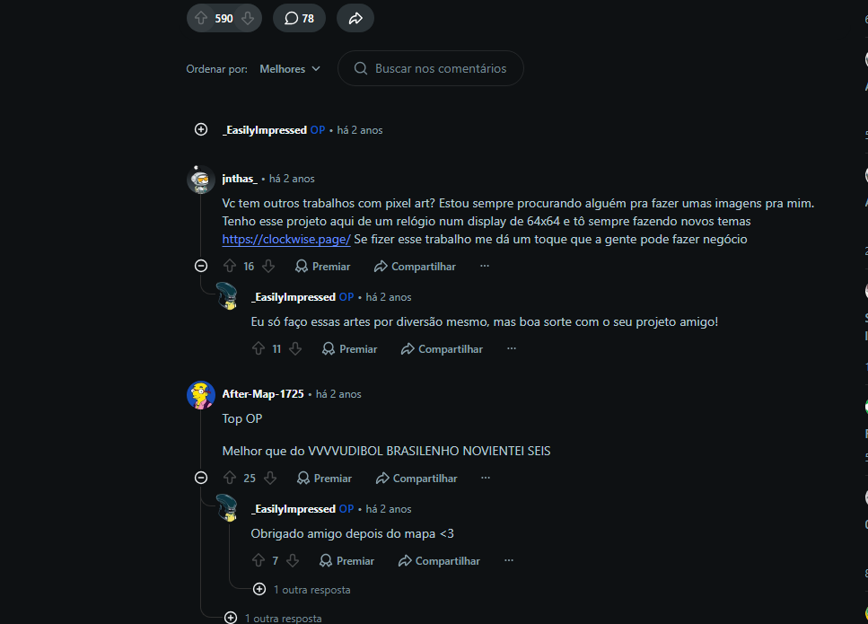

# FutCoin

Jogo 2D de futebol de moeda para dois jogadores locais, desenvolvido em Godot 4.7 para o Trabalho 2 de Desenvolvimento de Jogos da UFJF. Os jogadores compartilham o mouse e alternam lançamentos em um campo com paredes e 22 pregos, em pixel art com resolução base de 640×360.

## Como jogar

1. No menu, escolha **Jogar**, selecione os clubes e comece a partida. Há nove clubes disponíveis, sem repetir o mesmo nos dois lados.
2. Na sua vez, espere a moeda parar, clique nela com o botão esquerdo e arraste para trás. A seta mostra a direção do lançamento e sua força.
3. Solte o botão para lançar. A moeda pode rebater nas paredes e nos pregos.
4. Marque mais gols que o adversário durante os cinco minutos de partida. Em caso de empate, o próximo gol decide no **Gol de Ouro**.

O primeiro time é sorteado. Após um gol, a saída é de quem sofreu; no Gol de Ouro, há novo sorteio. Se o tempo acabar durante um lançamento, a jogada termina antes da definição do resultado.

| Controle | Ação |
|:---|:---|
| Botão esquerdo do mouse | Selecionar opções; clicar, puxar e soltar a moeda |
| Esc ou botão de pausa no HUD | Abrir a pausa durante a partida |

A pausa permite continuar, reiniciar ou voltar ao menu. A tela de resultado permite iniciar outra partida ou trocar os times.

## Executar o projeto

Abra `project.godot` no Godot 4.7 e pressione **F5** para iniciar pelo menu principal. O projeto usa o renderer Forward+ e abre em 1280×720, com resolução interna de 640×360 e escala inteira.

O executável Linux será disponibilizado em `build/` na etapa final, após exportação e teste no ambiente alvo. Ele ainda não está incluído nesta versão do repositório.

## Organização

| Pasta | Conteúdo |
|:---|:---|
| `scenes/` | Cenas de partida, entidades e interface |
| `scripts/` | Regras, física, câmera, dados dos clubes e interface |
| `assets/` | Arte, animações, shaders e áudio |
| `tests/` | Verificações de física e regras |
| `.docs/` | Enunciado, requisitos e documentação do trabalho |
| `build/` | Destino da entrega Linux |

## Integrantes

- Gabriel Lineker
- Gianlucca Paiva

## Créditos

As atribuições também estão disponíveis na tela **Créditos** do jogo e no [inventário de assets](.docs/creditos-assets.md).

Tela de confronto: Gianlucca Paiva. Motor: Godot Engine, licença MIT.

Torcida de gol: [misjoc — Small crowd cheering, Freesound 400590](https://freesound.org/people/misjoc/sounds/400590/), CC0.

Brasões dos times:
_EasilyImpressed

url origem https://www.reddit.com/r/futebol/comments/1enir7l/tava_sem_nada_pra_fazer_e_resolvi_desenhar_os/?solution=f43259329901d7a5f43259329901d7a5&js_challenge=1&jsc_token=2824be10929bdc604753c70a67a1c33181ba4b699c6260539e0be63db520029f&jsc_orig_r=

Prova de autorização

Music by <a href="https://pixabay.com/pt/users/lightyeartraxx-26697863/?utm_source=link-attribution&utm_medium=referral&utm_campaign=music&utm_content=109307">Kim Lightyear</a> from <a href="https://pixabay.com//?utm_source=link-attribution&utm_medium=referral&utm_campaign=music&utm_content=109307">Pixabay</a>

Music by <a href="https://pixabay.com/pt/users/retro-bgm-chan-55246343/?utm_source=link-attribution&utm_medium=referral&utm_campaign=music&utm_content=516327">Retoro BGM Chan</a> from <a href="https://pixabay.com/music//?utm_source=link-attribution&utm_medium=referral&utm_campaign=music&utm_content=516327">Pixabay</a>

Sound Effect by <a href="https://pixabay.com/pt/users/dragon-studio-38165424/?utm_source=link-attribution&utm_medium=referral&utm_campaign=music&utm_content=419025">DRAGON-STUDIO</a> from <a href="https://pixabay.com/sound-effects//?utm_source=link-attribution&utm_medium=referral&utm_campaign=music&utm_content=419025">Pixabay</a>
